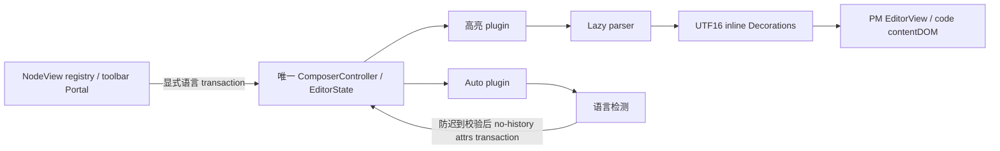

# Composer Code Block 高亮与自动语言

校准日期：2026-10-14。状态：有边界的静态链已确认，正式语言、高亮与 Auto plugin 已接线；定向回归通过，新 Electron 富输入 Gate74/74、current聚合22/22通过，默认前端127/127批与标准GUI smoke已通过；原wrapper失败保留，组合续跑步骤关闭。

参考 Codex Desktop `26.1007.30912` / build `20156`、bundle `com.openai.codex`，ASAR SHA-256 `75e397e2280dde93b70a85aa926f4282c728eacc84dfeb15ba7fb6ddd84628af`。完整审计、81 个原成员 UTF16 锚点及语言目录曾保存在 `.lime/qc/composer-code-highlight-audit/`。2026-10-14 用户释放空间时删除该目录，原件现已缺失；15 项产物的旧 manifest SHA-256 `35c932d1fb359d22320772c90587c429fadceb5cf94fe1b8f52c5efd46580cd7` 仅为历史记录，恢复版必须独立取摘要和验证。

REA Evidence `ev_32f87b5f925c87d58fbcfc530fbc03bc33536ab477882f98e9e2a9a70bbb150f` 只覆盖三个 inert 声明文件、13043 bytes、3233 AST nodes，parse failures 0，structural complete / semantic unknown。具体分支由原成员普通 Acorn AST 补证，五个成员摘要与 ASAR header integrity 一致。未执行参考应用、lazy loader 或 grammar，不能将该证据提升为运行准确率或全应用 reachability。

## 两个独立 plugin

`rich && code` 创建高亮与 Auto 两个 plugin；有效 plain mode 移除两者。NodeView 只更新 metadata、class 和 toolbar，代码正文仍属于 PM contentDOM，不使用 HTML 或 React 语法渲染器替换其子树。

高亮 cache 为 `Map<codeBlockPosition, [PM Node, Decoration[]]>`。事务映射删除失效位置，正文或 attrs 改变使 `node.eq` 不成立而清缓存；未变化但移动的块映射原 Decorations。parser 输出 HAST 后转为 inline Decoration，范围使用 UTF16 与 `nodePosition + 1`。plaintext 的空结果也缓存。

原成员补查区分了底层 parser 与主 Composer 的输入：`gRc`（initial `[10242007,10242330)`）采用 `BVr`（`[3561285,3561361)`）作为 languageExtractor，先按 UI canonical/alias 目录过滤，再处理 math/mermaid；plaintext 提前返回空 Decorations。`dRc` 默认接受 raw attrs，`SRc` 的 raw parser 才拥有 53 grammar 和 5 组专用别名。完整注册 raw parser 不意味着主 Composer 也放开额外语言。HAST 到 PM 的参考投影只把 root element 的完整范围转为 inline Decoration，不递归生成内层 scope；grammar 的嵌套 token 能力与主编辑器的显示投影分别验证。上述结论来自同身份原成员普通 AST，不新增 REA semantic 或运行结论。

异步 parser 完成后刷新当前 EditorState；不将捕获的旧文档 Decorations 写回。pending Set 与 `view.isDestroyed` 约束 dispatch。上游 parser loader 失败固定使用无高亮 fallback；detector loader 失败会重置后允许再次请求。两者恢复策略不同，不能概括成统一自动重试。

## Auto 事务与失效

每个 View 的 `WeakMap<PM Node, Promise<language|null>>` 按节点 identity 缓存检测。初始化调度，文档变化后延迟 150ms；捕获 generation 和文档对象。等待 detector，以及必要时等待 parser 后，均重新确认 generation、同一文档对象和 View 未销毁。

仅处理 `spec.code === true && autoDetectLanguage !== false` 的节点。回写前重新检查当前位置与属性，以 `setNodeMarkup` 保留正文及其余 attrs，并设 `addToHistory=false`。新节点 seed 检测缓存，避免自动 metadata 回写重复检测。当前 selection 所在代码块从非空清为空时，映射旧文档确认身份后清 `language`；不无条件清扫全部空块。

自动 attrs 会改变文档；高亮 Decorations/meta 本身不会。Lime 必须分别验证 draft revision、发送 receipt 和 undo，不能由无历史标记推断这些接线已正确。

## 语言事实源

| 集合                      | 数量 | 用途                          |
| ------------------------- | ---- | ----------------------------- |
| Picker languages          | 41   | 工具栏显示，保留源顺序        |
| UI aliases                | 21   | trim/lowercase 后归 canonical |
| Auto subset               | 39   | Picker 排除 math / mermaid    |
| Parser grammars           | 53   | 高亮能力，不自动扩大 Picker   |
| Parser extra alias groups | 5    | parser 专用别名               |

Auto 决策顺序：空白返回 null；URL、headers、log 形态返回 plaintext；JSON/XML 和 15 条有序语言启发式优先；不足 12 UTF16 字符且无命中返回 plaintext；其余 `highlightAuto` 限定 subset，只有 relevance ≥2 接受，异常或未识别回退 plaintext。具体目录与正则保存在本机 `catalog.json`，不能把静态规则例子当实际执行输出。

Auto 选择写 `language=null, autoDetectLanguage=true`；Plain text 写 `language=plaintext, autoDetectLanguage=false`；显式语言关闭 Auto。math 高亮归 latex，mermaid 没有高亮映射；不据此增加公式或图表预览。math / plaintext display label 与语言选择器一起覆盖五语言。

## 实施与验证边界

唯一 owner 仍为 `src/components/input-kit/`。语言目录与规范化复用一个 owner；高亮和 Auto 保持独立 plugin；Registry / NodeView / Portal 只消费同一 Controller 与 View。新增描述性类名属于 Lime 实现命名，上游原开发名称仍 unknown。

验证需要真实 parser token spans、UTF16 范围、移动块映射、正文与 attrs 失效、plain mode、manual false、150ms debounce、迟到结果、销毁、restore、undo、资源与 receipt。明确 disabled / IME 策略，这是 Lime 的保护选择，上游外围保护未确认。真实 Electron 必须显示 token、操作 Picker、继续编辑、发送同一 canonical 内容并恢复 attrs；仅 `language-*` class 或 label 不足。

参考实时检测质量、core tie-break、全部 grammar 语义、实际 loader 恢复、系统 IME 和 Windows 仍 unknown / not-run。静态研究完成不等于产品对齐完成。继续执行见[当前计划](../../exec-plans/codex-gui-alignment-current-plan.md)。

正式迁移的直接依赖锁为pnpm-lock.yaml（pnpm9.15.9）；lowlight3.3.0仅提供HAST，highlight.js11.11.1独立core检测，jsonc-parser3.3.1校验JSONC。新fresh rich-1 Gate实测Auto检测JavaScript→Plain无token→explicit TypeScript真实const token，语言动作不发input；后续编辑/Send/cancel/history保留正文和typed范围。构建护栏现追踪真实pnpm lock/workspace输入，先红2项后30/30，不能复用锁变化前产物。证据及完整覆盖限制见执行计划；53 grammar的全部参考语义仍未逐项实测。
