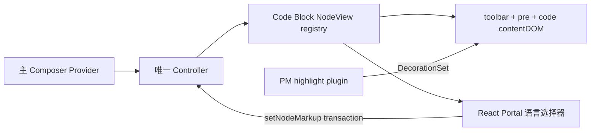

# Composer Code Block 的 NodeView 与语言选择器

校准日期：2026-10-14。状态：参考静态合同已确认；Lime 正式 NodeView、Registry、Portal 与两项 plugin 已迁入，定向验证通过，新的真实 Electron 富输入 Gate 74/74、current 聚合22/22；默认前端127/127批与标准GUI smoke已通过；原wrapper失败保留，组合续跑步骤关闭。基础 schema 历史 Gate 不能替代本切片。

参考身份复用[主输入审计](./main-composer-audit.md)：Codex Desktop `26.1007.30912` / build `20156`，ASAR SHA-256 `75e397e2280dde93b70a85aa926f4282c728eacc84dfeb15ba7fb6ddd84628af`。本次重新核对三个原成员的摘要：

| 成员                                    | SHA-256                                                          |
| --------------------------------------- | ---------------------------------------------------------------- |
| app-initial-6350d04672d0.js             | 604b5d2de4fbb41f3d0dc5b3662129c558e1c7b8aac8cc87225286f58dcfaf8f |
| app-primary-6f60e9ac4103.js             | 7fe9c00b03cb1de3ebc3a4bf298fc44b13a7fe67ca9cc335a9e2ecda969a1321 |
| local-conversation-page-a83a1af2c24b.js | f6275448cc603026ca3567e60a8c48d77d2b24cdc431c882280bbaa84b6010a0 |

REA Evidence `ev_bf209739980b2025edc530e2be3a7758959de28623928c7cb1af33d1ce38308f` 分析三个 inert 声明文件，15761 UTF8 bytes、4935 AST nodes、parse failures 0。structural complete，semantic unknown，1005 个保守 unknown；无完整模块 bootstrap/imports、原应用 reachability 或运行证明。具体调用分支由完整原成员的普通 Acorn AST 补证，不冒充 REA semantic 结论。压缩局部名不是上游原始开发名称。

完整审计、86 个原 UTF16 半开区间锚点、slice identity 和测试矩阵曾保存在 `.lime/qc/composer-code-nodeview-audit/`。2026-10-14 用户释放空间时删除该目录，原件现已缺失；旧 manifest SHA `4900789d…` 仅为历史记录。本页保存继续实施所需的仓库事实；恢复候选重新取摘要和验证，原成员不复制到生产源码。

## 主路径与 owner



主 Provider 调用（primary `[1426982,1427148)`）只有 composerController/defaultText/defaultTextKind/initialDocument/onDocumentChange/onDocumentDispose/children，不含 controllerOptions 或 spread。自建分支（initial `[11203980,11204238)`）启用 rich/code/selected-text-links，plain text 来自 setting。外部 Controller 分支提前返回，自建 defaults 不适用于它；外部初始 options 仍 unknown。

Controller 的 `cBc` 条件为 `enableRichText && enableCodeBlocks && !plainTextMode`；两处 nodeViews 装配在 PMU entries 后覆盖 `code_block`。registry 构造为 `new jRc()`，没有 options。PMU fallback、用户 setting 的真实取值和参考应用运行效果未验证。

registry（initial `[10245611,10246515)`）持有 NodeView entries、稳定 cached snapshot 和 listeners。createNodeView 登记；update 发布新的 entry；destroy/unregister 注销并通知 Portal 清理。UI 仅消费 registry，不持有第二份代码正文。

## 编辑 DOM 与事务

NodeView class（initial `[10246520,10251404)`）的结构为：

```text
div[data-composer-code-block="true"][data-composer-code-block-wrap="false"]
  div[data-composer-code-block-toolbar="true"][contenteditable="false"]
  pre[dir="ltr"]
    code[spellcheck="false"].hljs[.language-*]
```

code 是 PM `contentDOM`；toolbar 的 mutation 和事件被隔离，代码编辑仍交给 PM。update 对 foreign node type 返回 false；同 type 更新 attrs/entry/外层展示。NodeView 只更新 class/dataset，不通过 innerHTML、textContent 或 React syntax renderer 替换 contentDOM 子树。

`selectLanguage`（initial `[10250586,10250955)`）重新查询 getPos 和当前 node，失效位置/非 code node 直接返回；用 setNodeMarkup 保留其余 attrs、正文和 selection。Auto 写 `language=null, autoDetectLanguage=true`；选择 null 的 Plain text 且 schema 支持 auto attr 时写 `language="plaintext", autoDetectLanguage=false`，不支持 auto attr 才保留 null；显式语言写该语言并关闭 auto。不从 submission 的省略规则推导 UI label。

主 Portal 只观测到语言选择器：搜索、Auto、Plain text 和语言项。`getWordWrap` 默认 false，缺少 wordWrapAttribute 时 setter 无效。本主路径没有 wrap/copy/preview 控件证据，不将其他 surface 的配置搬入主 toolbar。语言 catalog/alias 和 Auto 回写的静态链已在[高亮补证](./composer-code-highlight-audit.md)闭合，实际运行效果未验证。

## 高亮与命名边界

`dRc`（initial `[10239875,10240828)`）由 PM plugin state/cache/decorations/promises/refresh meta 承接高亮，props.decorations 返回 PM DecorationSet。NodeView class 的 hljs/language-\* 只表示展示类别，不能单独证明 parser 已高亮。[高亮补证](./composer-code-highlight-audit.md)已确认按位置与节点相等性失效的 cache、UTF16 Decorations、独立 Auto plugin 和防迟到事务；正式产品已接线，实际 token、revision/receipt 和五语言回归已通过；新富输入/current进程证据与组合默认步骤已关闭，限制见执行计划。

`CodeBlockNodeViewRegistry`、`CodeBlockNodeView`、`CodeBlockToolbar` 是 Lime 的实现命名；上游原文件/类 descriptive names unknown。可对齐原成员可确认的方法属性：createNodeView/getSnapshot/subscribe/unregisterNodeView/publishNodeViewUpdate/destroy/ignoreMutation/stopEvent/update/selectLanguage/getAutoDetectLanguage/updateCodeElement/focusEditor/getContent。不得迁入 jRc/MRc/XBc 等压缩符号。

## Lime current 实现与验证

继续使用唯一 input-kit Controller/EditorView/Transaction owner。registry 放在 Controller 生命周期；Portal 绑定实际 View 的 toolbar entries，View 销毁后移除；禁第二编辑器或资源 store。语言事务不得推进无变化 revision、丢失富草稿、使迟到 receipt 清掉新输入。

基础 schema 的 pre/code DOM 可服务 serialization/clipboard；主编辑器的旧 `pre[data-composer-code-block]>code[data-language]` 观察必须迁移到上述 NodeView DOM。测试不为旧结构保留兼容分支。共享样式采用 Lime theme tokens，迁移时删除重复规则；多模型与首页 Banner 继续既有 owner。

验收覆盖 registry 稳定 snapshot/通知/注销、两 code blocks、语言事务与 undo/redo、stale getPos、disabled、toolbar 与 content mutation 隔离、正文/selection/IME/paste、五语言可访问名称、Portal 与 listener 清理。高亮若接线必须独立证明 token range、Decoration mapping、language 切换、异步过期结果和销毁后无 dispatch；Auto 检测结果不能由静态 label 代替。

真实 Electron 用新 DOM oracle 验证语言切换、继续编辑、Send、canonical readback、history/cancel 和无额外 input，重新冻结源码与实际 renderer/Host/sidecar。主题、多模型、Banner 是保留差异；Windows、系统 IME、原生录音和安装后的应用验收分别登记，不以 DOM synthetic events 替代。

2026-10-14 正式接线：`src/components/input-kit/` 的 Controller 唯一Registry、PM contentDOM、React Portal和独立highlight/Auto已应用；旧主DOM观察与历史fixture直接迁移，无compat双轨。真实五语言资源测试先红5项，修正为agent namespace后5/5；Toolbar与主Editor接线合计41/41，相邻消费者141/141、fixture189/189。fresh rich-1 Electron Gate74/74确认可信语言选择、正文高亮、单次发送、cancel/history与同canonical输入，证据与45项源/464项renderer/Host产物摘要关联。该结果属于controlled external backend与macOS Electron，不证明参考应用运行、OS IME或Windows；current聚合及default关闭状态以执行计划为准。
