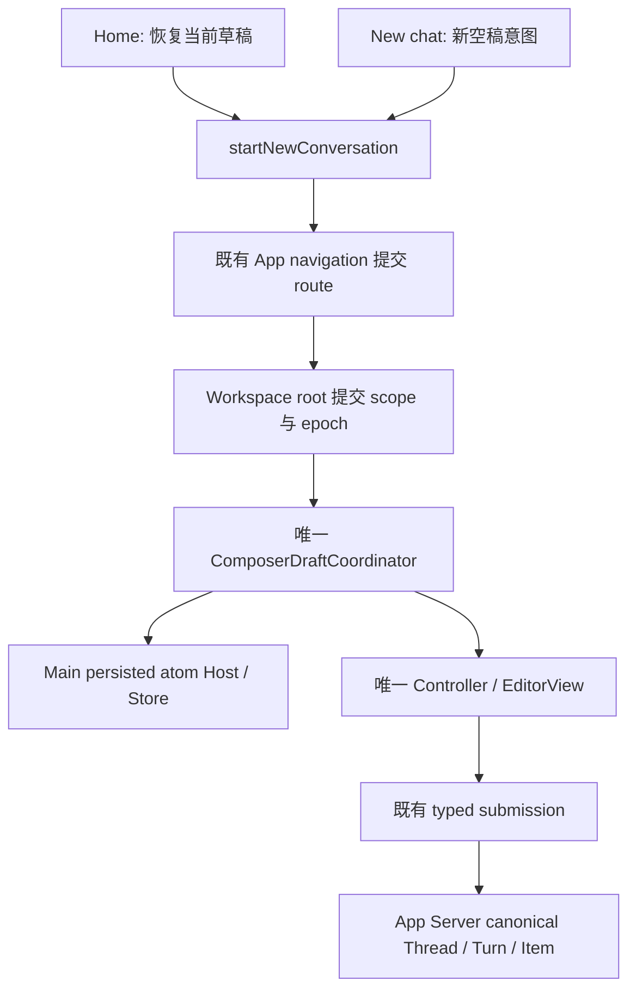

# Codex Desktop 公开新建会话与草稿导航审计

状态：设计与源码迁移已完成；packet21 的三入口完整富输入首发、rich Stop、Home 冷零写及三工作区两次正常冷恢复四项真实 GUI 合同全部通过。后续 packet22 的程序化发送绑定修复已通过原 Skills 三路径和桌面壳，完整 current 聚合22/22已通过，默认门禁正按原失败批次续跑。整体 GUI 继续 partial；下文逐轮失败属于原身份历史证据，不能覆盖新产物。

目标为 `/Applications/ChatGPT.app` 中的 `com.openai.codex`，版本 `26.1007.30912`、build `20156`；ASAR SHA-256 为 `75e397e2280dde93b70a85aa926f4282c728eacc84dfeb15ba7fb6ddd84628af`。安装路径不能作为消费者 ChatGPT Desktop 的身份依据。

## 证据与边界

复用 REA Evidence `ev_8109ba0f2d675fb08989285ee7408e675b5a2d4953513f757c11e959c4934ab5` 的五个完整 member，以及 `ev_5872c498b099311cff8f5d0c5d7ca8b99dae35efcceb3f42eeabd3eb526e9c47` 的 27 个 focused inert 声明。恢复候选核对了 46 个证据文件，摘要一致；没有新增分析 chunk、执行 bootstrap 或参考应用。

已确认公开导出名 `startNewConversation`。initial member 的 `wH [4012522,4013720)` 返回首页、聚焦 Composer，仅在 freshDraft/task metadata 等分支重置身份；`h7r [4013720,4013868)` 是相邻导航调用。侧栏调用链见 `les [7997002,7998775)`、`ses [7996562,7996734)`、`Ati [4062791,4063226)`。这些压缩局部变量不能当作上游开发源码名。

shared 的 `fRn [3640958,3641256)`、`sRn [3640457,3640611)` 与 `TRn [3643120,3643439)` 支持 home/panel 的 current client identity 和 canonical materialization 后解绑的静态映射。是否存在所有未发送草稿的侧栏 picker、普通 New chat 的运行时 fresh 行为、预热时机和全部窗口状态仍 unknown。

## 迁移前差距（保留原始审计事实）

| current 路径                                                                                         | 已观察问题                                                                    | 迁移目标                                          |
| ---------------------------------------------------------------------------------------------------- | ----------------------------------------------------------------------------- | ------------------------------------------------- |
| `useAgentChatWorkspaceCommandWiring` / `useWorkspaceResetRuntime`                                    | 初始 Home 已使用稳定 `home/new-conversation` scope                            | 保持唯一 root bind owner                          |
| `useAppSidebarConversationActions` → `taskCenterDraftTaskEvents` → `useTaskCenterNewTaskPageRuntime` | Home 与 New chat 共用 cancelable event，进入随机 `task-draft-*`               | 统一公开 `startNewConversation` 动作和显式 intent |
| `useTaskCenterDraftMaterializationRuntime`                                                           | 输入触发 1 ms 预热，维护 direct/materialized 首发双轨                         | 必要 session 创建只在既有发送主链承担             |
| `useWorkspaceComposerDraftIndex` / draftTabs / tab chrome                                            | 恢复 metadata，但 general GUI 没有公开选择 consumer                           | 清理随机 UI 状态，不据此新增 picker 或恢复 strip  |
| 新建事件的项目参数                                                                                   | 显式 null 被兜底为当前项目；请求其他项目被 ignore，listener 仍 preventDefault | null 保真，按真正提交的 route/scope 执行          |

canonical session tabs、sidebar Thread 投影、后台运行/queue、Canvas 和 image workbench 有真实消费者，需按引用迁参；不能根据名字包含 tab 批量删除。标题 helper 先迁到既有 header owner，再清理 dead general chrome。

## 实施合同

Lime 决策为 Home 使用 `freshDraft:false` 恢复当前稳定草稿；明确 New chat 使用 `freshDraft:true` 开始空稿。普通 Codex sidebar 的静态参数未强制 fresh，因此不能把这项严格 fresh 决策写成参考运行事实。

动作由现有 `useAppNavigation` 持有，经 App props 传给真实调用者；不另建 event bus、context store 或业务后端。`buildHomeAgentParams` 保持纯 route 参数构造职责。进入 owner 后 projectId 必须显式，undefined 与 null 不混用；Logo 的无项目行为明确传 null。

1. 导航请求只 flush source。路由被阻塞、延迟或拒绝时保留旧正文、资源和身份，不能把 void onNavigate 当作成功确认。
2. 读取真实 committed route/request identity；连续请求有独立 epoch，不能只依赖 Date.now。fresh 同 scope 也递增 epoch，重复 effect 只消费一次请求。
3. 目标 scope committed 且 bind ready 后，由同一 Coordinator 执行受保护的 fresh CAS；CAS applied 后才清空正文。现有乐观 `clear()` 不能直接充当成功的新建确认。
4. 检查 request、epoch、scope、generation、opaque binding、draftId/scopeVersion 与 Controller revision。更新期间编辑、再次导航、冲突或不可用结果不能清除新编辑；Stop exact revision token 不放宽。
5. 空稿 identity 允许为 null，下一次有效编辑分配新逻辑 draftId；需证明旧 identity 已退休，不用随机 tab ID 伪造空稿身份。
6. 首发沿已有 typed acceptance → canonical receipt → home/local promotion/consume。晚到 receipt 只处理其 captured source，不接管最新可见 target。

## 写集、清理与验证

按公开动作/intent → 随机草稿与预热删除 → dead chrome 与测试护栏迁移三步实施，完整迁移后才关闭切片。Host/IPC/schema 暂不夹写；`draft` wire kind 是否删除，待全部真实消费者清点后另同步协议、消费者、fixture 和 contracts。

迁移旧 event receivedDetails、跨项目 ignore/null 沿用、禁止 onNavigate、warmup 预算、random index、第二层 tabs 正向断言与强制 draftTabs 字符串护栏。继续覆盖唯一 root bind/no parallel store、失败保稿、迟到 receipt、canonical session/Canvas、Stop 恢复、workspace 隔离与后台 queue。

必要证据包括公开点击 → 真实 route commit → root bind → Main/IPC/store → 完整 PM JSON/selection/resources → canonical receipt 与用户可见结果。定向真实 owner 回归、typecheck、相关 contracts/脚本治理、GUI smoke 与对应 Electron Gate B 分别报告；source-only 设计不能替代运行证据。

current：startNewConversation、committed route/request、稳定 home/local scope、Main/Coordinator/Controller、typed acceptance 与 canonical 消费者。compat：不新增。deleted：general 随机草稿、discovery、新建事件、新页/预热/materialized owner 和旧 general chrome，9个文件直接删除，调用者/测试/护栏同步迁移。

设计与源码迁移完成度100%；本切片local16三工作区/两正常cold与Home6稳定Home冷恢复已分别通过，三首发尚未关闭，整体GUI继续partial。root复核78项before/after与冻结证据后正式采用，收据 .lime/qc/new-conversation/formal-adoption.json；保留Settings及旁路增量，未提交代码。架构4.3/4.5由root于2026-10-15确认。正式最新逐文件46suite/540项已通过（formal-latest-directed-receipt.json），非单次全绿：初轮538通过/2失败，Stop夹具未提交可见local会话，按真实产品投影迁移后17/17与EditorView5/5；产品与严格恢复门禁未改，原失败保留。候选438/438与strict3187零诊断独立记录。

可见目标就绪门禁已窄组合：status.ready只投影真实binding.ready，Runtime要求精确visible scope匹配；首次读取被替代、失败/模式不匹配时禁止编辑。相同EditorView回归在正式新导航上5项行为红，隔离两产品叶修复后5/5，正式5/5与Stop17/17已通过；严格scope/generation/revision/token守卫保持。local11静态窗口成立，是否实际命中仍缺timeline，不倒推为已证明根因。

packet19的Home首发已取得完整canonical富输入、资源字节、consume/new-edit和Main96352正常退出证据；search-new在替换已保存probe后出现保存冲突，项目新建未达，三首发整体仍fail。queued discard通知重绑已在既有Coordinator真实回归复现并窄修，严格CAS不变；新构建、原三入口与Stop/冷恢复/默认门禁按current计划继续验收。

queued discard修复的新renderer、标准typecheck、freshness与桌面壳通过。packet20 first6 Home/search-new全部业务及正常退出通过；项目按钮补真实header hover的fixture后Node53/53/lint/格式通过，packet21 first7三个入口完整canonical输入/资源/消费/新稿保护均过。第三次正常quit超过原15秒期限，随后normal teardown仍保留整轮fail；first8只补被动退出诊断，所有原断言/期限保持。三首发与Stop/冷恢复/current/default不据业务断言局部通过宣称整体关闭。

packet21 新产物的四项真实合同均已通过：first8 三入口完整canonical富输入/资源字节/consume/new-edit与三次原15秒内正常退出；rich Stop原场景恢复/历史/marks且零console/page errors；Home7完整富稿/原选区/identity与cold零写、两正常Main；local17三工作区拒绝保稿/Undo/消费新稿/隔离与两正常cold、三Main正常退出。first8只加被动生命周期计时，旧退出超时根因仍unknown且失败保留。此4/4（100%）仅指四项合同，整体GUI仍partial；原Stop文件在原5秒期限单次20/20已通过，前次timeout仍保留；async-tabs已迁canonical筛选、current侧栏路径与完整计数，3+11通过；current聚合guard293/294、collector隔离68/69的原5秒超时保留。仅优化测试采集器重复工作后69/69、溢出用例1571ms，原断言/timeout与独立oracle不变；聚合第3轮Skills接线缺陷已另修复；packet22第4轮22/22全部通过、前后源码/产物零漂移，default按原状态续跑中。
