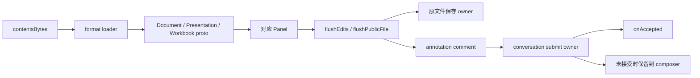

# 专业文件预览、保存与批注补证

证据有效性更新（2026-10-18）：旧`.lime/`整个目录已消失，下文旧原件路径/收据/截图/清单均missing；原执行结果只保留历史观察。详见[缺失声明](validation-evidence-lifecycle-20261018.json)。新表格静态合同已独立绑定同ASAR，当前产品验收须使用新候选，不恢复旧通过收据。

状态：current / 四格式预览与统一批注已分别验收；XLSX普通单元格和CSV/TSV同源保存已验收；PPTX编辑实现与原生验证接续，最新根门禁未关闭。更新：2026-10-17。

安装包的静态连接包括 `binary → proto → Panel → flush → conversation annotation submission`。Lime四格式预览/批注有1.159.0固定候选收据，XLSX编辑/保存及三格式共享回归、CSV/TSV同源保存有1.160.0独立收据；证据身份不可互换，也不代表根并行后端已通过。Presentation正文/对象编辑和导出保存正在扩展既有owner，尚未取得本轮原生编辑收据；DOCX/PDF编辑需确认具体入口，进程重启耐久性仍unknown。实施/验证状态由[专业文件计划](../../exec-plans/codex-professional-files-alignment.md)、[工作簿计划](../../exec-plans/codex-workbook-alignment.md)及[Presentation计划](../../exec-plans/codex-presentation-alignment.md)持有，下文阶段记录保留当时事实，不作为另一份active checklist。这不评价Agent生成Office/PDF文件的能力。

## PPTX 本地编辑与保存 caller 补证（2026-10-17）

复用本页原ASAR和caller parent `ev_7e96cf795451f834a7bddc70daacbc950320070656781f6347f1cf9c759e4299`，presentation parent `ev_363dcdc24c3bb1717c709daf6b82fb17bb7878999d041c4feb0804fd16d24069`，editor view `ev_99db9c395716d39135d83502ab0327e4e23c8639a2b08b606208dbdbf992be56`。原ASAR及5个成员已重新核摘要；40段有界原成员UTF-16上下文保存在 `.lime/qc/professional-files/presentation-edit-reference-20261017-1/local-caller-contexts.json`（SHA `7c0b0a9b1b04590741a3509d945ca79920666665c105b126684d5630958763c0`），结论与unknown保存在相邻 `local-caller-findings.json`（SHA `6885eed948d2f43fdca490a4ff732aed6dc3257a6bd47944a049b8781c2688cb`）。这是绑定已有REA身份的静态原件补读，未重跑producer、未执行参考应用，也不新增REA Evidence ID。

| 原caller UTF-16 offset | 已观察合同 |
| --- | --- |
| 76216、76632、105382 | 开关1292007209、非durable/template/attachment及workspaceFiles读写能力决定presentationEditingEnabled |
| 115758、115879、122837、123292 | 原PPTX sourceBytes、format、isEditing与onPresentationEdit传入本地SidePanelPresentationPanel→PresentationPanel，实际编辑再受CRDT publishing readiness约束 |
| 119447、119554、135555 | 编辑通知惰性导出proto，500ms防抖/串行队列；drain触发flush |
| 115163、115409 | 首次重读同host/path并比较载入字节/ETag，随后同host/path以ifMatch写入 |
| 13572、114644、115638 | dirty队列、关闭/下载/分享等动作前flush |

本地caller有正文/对象编辑和原路径保存接线，不经过通用remote PresentationEditor。原版通过Walnut完整proto导出PPTX；Lime原包定点修改是明确实现选择。`setEditingEnabled`、`textActivateBlockEnd`、`textHandleInput/CompositionEnd`、`nudgeSelectedElements`、`updateSelectedElementFrame/Style`、`deleteSelectedElement`和undo/redo可以按语义对齐；压缩内部类名不能照搬。开关实际值、参考运行成功、workspaceFiles下游ifMatch执行、原始非压缩类名和完整remote保存owner仍unknown。

## PDF 实施补证（2026-10-17）

沿用下述安装包身份，新增四个 inert 原成员。REA parent `ev_87ba97728327a9b942255e18bb42d20c39afb710e85305de5b35548b614be8f4`、summary `ev_bb295d0f43112d8bf88f335dd0da981fa9dc60060955985b3ded499fd170b374`、模块页 `ev_b4465e2dd9ecf11eb4a3cda2cf356f6e60c800bc15a5e86fb70790b1db06c060`；application partial，8056 semantic unknowns。26 个 session records 已导出并保留，未重复运行目标。

| 原成员                                        | SHA-256                                                            | 已读范围                                                                                                                   |
| --------------------------------------------- | ------------------------------------------------------------------ | -------------------------------------------------------------------------------------------------------------------------- |
| `pdf-preview-panel-d46b52f0eb1a.js`           | `1532d5f6037ad4d7a869021279cf90fe04d220b28a430cd02f39a4299de338a7` | 确认公开导出 `PdfPreviewPanel`；连续页面、缩放与可选文字；point/region 批注 metadata、页面截图及 `pdf-direct-comment` 分支 |
| `artifact-annotation-comment-c4d7f8bc29f7.js` | `13efae9cefb9b5badef4fe812983d784f66265ab1a10ad9291da3a298664e29c` | 通用批注转换；不能将其 Office target 错套为 PDF schema                                                                     |
| `artifact-comments-ff12aa65e0b7.js`           | `aa75eef5ef3e712c48c87f7c8a881ab711eeba465343c6b8b74841579a8f5e75` | comments 消费及提交边界，运行接线仍需另证                                                                                  |
| `docx-preview-panel-79829ce69ce8.js`          | `ced645d7edfa698d65983f4a902682447ddaa8cc478a8acdd7b456072cbe5286` | 绑定原件身份，未据文件名声称 DOCX 等价                                                                                     |

PDF 原成员显示 `localPdfContext.pageNumber`、`localPdfCommentMetadata` 的 `point/pagePoint/pageSize` 或 `region/pageRect/pageSize/selectedText/selectionKind/selectionRects`。截图含独立 `commentId/pageNumber/width/height/dataUrl`；提交前检查当前页面/文件/会话生命周期。此处字段来自普通静态阅读，不是运行时捕获，也没有将压缩局部名当作上游业务名称。

同摘要 DOCX 原成员的静态补读确认公开导出 `DocxPreviewPanel`，其 lazy renderer 为 `docx-preview-8513c2dacad2.js`；面板对 bytes 调 `parseAsync` 后校验 parts，再调用 `renderDocument`。固定选项包括 `renderAltChunks:false/useBase64URL:true`，分别渲染 clean 与 redlines（`renderChanges`）并按 `hasRedlines` 切换；存在分页、缩放、thumbnail 与位置反馈的消费。仅原成员阅读，不运行引擎，也未绑定或分析该依赖 chunk 的实现。因此下文 2026-10-14 表格中“DocxPreviewPanel 内部未读”的历史边界已推进到上述有限合同，保存/roundtrip 与实际 DOCX 渲染仍未知。

Lime 新 current owner 为 [PdfPreviewPanel](../../../src/components/artifact/document/PdfPreviewPanel.tsx)、[pdfDocument](../../../src/components/artifact/document/pdfDocument.ts) 和 [PdfPageView](../../../src/components/artifact/document/PdfPageView.tsx)。会话 artifact 与文件树 binary/ready 选择统一进入 `PreviewArtifactRenderer`，PDF 不再由抽取文本或系统打开承担主要预览。PDF.js 6.4.299、worker、字体/CMap/WASM 通过 Vite 本地资源打包；源字节经既有 `fileBrowser.readFileBytes -> fs/readFile` 读取。没有新增 IPC、App Server method、runtime、canonical projection 或持久化 owner。

已观察的定向测试为 4 suite / 32 项、消费者 3 suite / 42 项（包含重叠项，不累加）；标准 typecheck、strict lint、版本与脚本治理通过。隔离候选已完成 Renderer/Host 构建和 sidecar 资源准备，freshness 全 ready；原生 PDF 和标准壳 smoke 的实际终态在执行计划补记。在原生结果确认前，不宣称 PDF 阶段完成；批注、Office、Windows/安装包、live 与最新并行 Rust 工作树仍未验收。

## 目标与证据身份

目标为 `/Applications/ChatGPT.app`，显示名 ChatGPT，bundle ID `com.openai.codex`，版本 `26.1007.30912`、build `20156`。沿用 [研究报告](report.md) 和 [证据索引](evidence-index.json) 的目标身份，不将它替换为另一个 ChatGPT 安装包。

原 ASAR SHA-256：`75e397e2280dde93b70a85aa926f4282c728eacc84dfeb15ba7fb6ddd84628af`。

复用 parent Evidence `ev_7e96cf795451f834a7bddc70daacbc950320070656781f6347f1cf9c759e4299`。以下 item view 都只检查 1 项，`total=502`、`complete-within-view` 指该项投影完整；不代表整个应用语义完整。parent 的主进程语义分析耗尽 worker heap，部分展开关系达到预算限制。

| 代号 | 原 ASAR 成员                                                       | 成员 SHA-256                                                       | REA item view / node ID                                                                                                                             |
| ---- | ------------------------------------------------------------------ | ------------------------------------------------------------------ | --------------------------------------------------------------------------------------------------------------------------------------------------- |
| L    | `webview/assets/artifact-preview-loaders.electron-9d76e08ff512.js` | `8c3a37109200729cd8bcd297dd9a9b029cf98b6f2099eadbc8b4b0af35e5977f` | `ev_607d48f23f31889a44d6468c569af5b837ef0956459bcc3aaa7310cc8af7df77` / `jag_node_6a502062646667f54c37ece39295f09c4daef37da0361cde0b71a52ccc9d8038` |
| A    | `webview/assets/artifact-tab-content.electron-68a541ab97f2.js`     | `e3d653f0d5e25d710a1128648fcb6395e376f44ddfa710e454f6ecb821021967` | `ev_a2da750b6759bf473cb6f43d13575574a724dee8641e474b189bdf862eef1c81` / `jag_node_257d9ca9d494cdb7d8fd00002b3a4a6b5ed8bd14ec9e48e5b5f409e29136ded5` |
| H    | `.vite/build/main-CqEoQDOU.js`                                     | `09d19386e1f23cf4ccbc950fc40d85a1e8a064a08be588b2a4be6a89f6ada9e6` | `ev_cc090da9ce27258dd9064a297a3f133fcb460d9ee1b3b19aa917140aaaeb269d` / `jag_node_f64cf419fd6f4e433b62959d4ba37f45f009f8b538aa7ae0b93c4d3f27b9bfff` |

三个原成员的本地 SHA-256 与来源清单一致。L 的已观察 export 名为 `n/t`，A 为 `a/i/n/r/t`，H 是 asset 节点且 exports 为空。A 尾部绑定 `Do as t`；L 为 `a as n`。这些是压缩 export 身份，不能用 lazy import 的 destructuring 反推目标面板 export 实现已验证。

REA view 证明保留的成员/模块身份和 export 名。以下行为来自校验过的原成员普通静态阅读，属于观察；跨函数用途属于有限推断。没有运行目标、执行 bundle/bootstrap、下载预览引擎或采集真实交互。表中 offset 都是**原成员 UTF-16 起始位置**，不是格式化文件行号。

## 最小静态合同

| 环节              | 观察与合同                                                                                                                                                                                                     | 定位                                   |
| ----------------- | -------------------------------------------------------------------------------------------------------------------------------------------------------------------------------------------------------------- | -------------------------------------- |
| binary 入口       | A 导入 L 的 `n as zi`；预览 effect 从 `contentsBytes` 调 `zi(e,a)`，结果保存为 `parsedArtifact`，异常转失败状态。此处证明 bytes 到 parser 的消费，不完整证明所有文件来源。                                     | A `10444`、`108836`                    |
| DOCX 解码         | `Document.decode(DocxReader.ExtractDocxProto(e,false))`，返回 `{kind:"document",proto}`。                                                                                                                      | L `2519`                               |
| PPTX 解码         | `Presentation.decode(PptxReader.ExtractSlidesProto(e,false))`，返回 `{kind:"presentation",proto}`。                                                                                                            | L `2769`                               |
| XLSX 解码         | `Workbook.decode(XlsxReader.ExtractXlsxProto(e,false))`，返回 `{kind:"spreadsheet",proto}`；people 缺失的 displayName 由 email/initials/id 补齐。                                                              | L `2988`                               |
| 其他格式          | CSV/TSV 分支调用 `Workbook.fromCSV(TextDecoder.decode(bytes), separator)` 再 `toProto()`；PDF/TeX 拒绝进入这条 loader，并指向 `PdfPreviewPanel`。                                                              | L `[1350,3190)`；PDF 锚点 `1855`       |
| document 面板     | A 的 `Zo` lazy import `PopcornElectronDocumentPanel`；document 分支传 `initialDocumentProto`，可同时传 `initialSourceBytes`、`initialSourceFormat:"docx"`。另有 `DocxPreviewPanel` lazy 入口，其内部合同未读。 | A `133897`、`121465`、`134426`         |
| presentation 面板 | presentation 分支传 `initialPresentationProto`、源 bytes/格式、review tools、comments/sidebar 和按条件启用的编辑回调；首屏回调为 `onFirstSlideRendered`。目标模块实现未验证。                                  | A `122655`；分支窗口 `[120700,125120)` |
| workbook 面板     | A lazy import `WorkbookPanel`；spreadsheet 分支传 `initialWorkbookProto`、源 bytes/格式、review tools、`manualEditUiEnabled` 和 controller 回调。代码有 feature/source/host 条件，不证明所有文件均能编辑。     | A `72609`、`124296`、`76688`           |
| flush gate        | 先 `await Ue.current?.flushEdits()`，再按 `ue` 条件检查 `Ge.current?.flushPublicFile()`；异常提示保存失败并返回 false。普通写回 owner 另有 `await Je() && await rt.flush()`。                                  | A `114115`、`114159`、`115678`         |
| 原文件写回        | 普通写回读 baseline 的 `etag`，经 `workspaceFiles.write({bytes,hostId,ifMatch,path})`；XLSX artifact-document 路径按原文件 `bindToExactFile`，经 CRDT drain、append 与 materialize 写回。                      | A `115512`、`46234`、`43013`、`62977`  |
| annotation 提交   | `onChatGptSubmit` 先检查 abort/current，再等待可选保存函数；若明确返回 false，则抛出原文件未保存错误。构造 comment 后从 `Sr` 按 conversation 取 submit owner，发 `artifact-annotation-direct-submit`。         | A `22165`、`22299`、`22469`            |
| 接受与失败保留    | submit 带 `isCurrent`（abort/current/同 owner）与 `onAccepted` 标记；未接受且未 abort 时，把 comment 保留到该会话 composer，并提示重试。另一路有 `artifact-direct-comment` Host 消息，尚未完整配对。           | A `22469`、`22726`、`19262`            |

这里的面板合同不是截图或布局验收。`flushEdits` 可选调用、`flushPublicFile` 条件调用以及 annotation gate 仅拒绝明确 false，都要求后续核对实际 owner/ref 注册和 readiness。不能由这条通用 gate 推导每一种 DOCX/PDF 都能编辑并成功保存。

静态调用示意如下；箭头表示已读代码连接及其接口，不表示观察到真实执行。

## 文件身份与 Host 保存边界

A 观察到 view key `file:${hostId}:${path}`，内部 scope 对象包含 `{conversationId,hostId,path}`（`15397`）。comments accessory target 包含 `{hostId,threadId:dt(conversationId),path}`（`[21800,23000)`）；comment 带 `commentThreadId`、随机生成的 `commentReplyId`、正文、label 和 `metadata:{target}`（`22299`）。这些 thread 字段分别服务会话和批注，不推断为同一种 ID。

面板导航 consumer 读到 document `pageNumber`、presentation `slideNumber` 和 workbook `range/sheet`（A `[120700,125120)`）；这只建立所选分支接受的导航字段，不是完整 annotation target schema。A 还有 `getAnnotationOriginatingTurn` prop（`96563`），其 producer 返回形状未验证；所选合同中未观察到 `itemId`，不把它扩写为已确认的 Thread/Turn/Item 关联。

H 的 `bindToExactFile` 通过 realpath 限定准确文件（`3097264`、`3097419`）；workspace root 必须获授权且为目录，public file 必须留在该 root 内并为 regular file（`3102253`、`3102458`）。操作重新解析路径，路径变化会拒绝（`3101451`）。这证明所读实现包含校验，不证明任意调用都能抵御所有竞争或绕过。

H `materialize`（`3099645`）校验入参与大小，计算 public bytes hash，调用 `store.beginMaterialization`（`3099926`），处理 materialized/stale、写冲突和 persistence failure，复核落盘 hash 后调用 `store.finishMaterialization`（`3100855`）。A 导出 XLSX 的静态分支载入 checkpoint/updates、recalculate，再 `XlsxExport.ExportProtoToXlsx`（`38166`）；更新序列的 stateVersion 连续性检查位于 `38449`。这表明保存有版本与冲突合同，不证明 roundtrip 格式保真、崩溃耐久性或完成的运行时注册。

## Lime 当前 owner 与缺口

| current owner                                                                                                                                                                                                                                     | 当前观察                                                                                                  | 对齐缺口 / 最小接点                                                                                                                                       |
| ------------------------------------------------------------------------------------------------------------------------------------------------------------------------------------------------------------------------------------------------- | --------------------------------------------------------------------------------------------------------- | --------------------------------------------------------------------------------------------------------------------------------------------------------- |
| [document-preview](../../../lime-rs/crates/document-preview/src/lib.rs#L61) 与 [tool-runtime 文件读取](../../../lime-rs/crates/tool-runtime/src/file_read_execution.rs#L418)                                                                      | DOCX/XLSX/PPTX/PDF 入口抽取文本，返回 String。                                                            | 缺少专业文件布局/区域模型及 renderer 合同；文本抽取继续归既有 owner，不因 GUI 需求建立第二 runtime。                                                      |
| [previewArtifact](../../../src/lib/artifact/previewArtifact.ts#L217)                                                                                                                                                                              | Office/PDF 归 document；有文本时 `document_text`，否则 `system_open`。edit 限定 Markdown/text/code/HTML。 | 缺少真实页面、幻灯片、工作表预览与编辑能力/readiness 投影。已识别扩展名不等于已有对应面板。                                                               |
| [CanvasWorkbenchPreviewModePanel](../../../src/components/agent/chat/components/canvas-workbench/CanvasWorkbenchPreviewModePanel.tsx) 与 [RightSurfaceHost](../../../src/components/agent/chat/workspace/right-surface/RightSurfaceHost.tsx#L135) | 已有工作台和统一右侧 surface，按 active pane 渲染。                                                       | 在同一 surface 接专业文件面板；文件位置、版本、批注 scope 与原文件保存须有单一 owner，不能另造审查工作区。挂载切换状态需实测。                            |
| [文件壳 API](../../../src/lib/api/fileSystem.ts#L21) 与 [workspaceRightSurface](../../../src/lib/api/workspaceRightSurface.ts)                                                                                                                    | 默认应用打开由 Desktop Host 处理，右侧 surface 请求走 App Server。                                        | 系统打开不能代替面板区域批注；新增文件操作应扩展既有协议/gateway/Host 边界并同步消费者与验证。                                                            |
| [ComposerController](../../../src/components/input-kit/ComposerController.ts) 与现有会话发送 owner                                                                                                                                                | 已有富草稿、history、acceptance 后提交保护。                                                              | 尚未在上述专业文件路径看到独立 annotation target、保存 gate 和会话 submit 的完整闭环；复用当前发送接受语义与唯一 composer owner，避免批注自建 turn loop。 |
| [文档导出](../../../src/components/workspace/document/utils/exportDocument.ts#L24)                                                                                                                                                                | Word 导出为 HTML 包装的 `.doc`。                                                                          | 该导出不是原生 DOCX 排版/批注 roundtrip owner，不能用它宣称已关闭缺口。                                                                                   |

这次的缺口结论限定到所读专业文件 current 路径，未以关键字零命中声称全仓不存在其他批注能力。候选迁移应先覆盖 PDF/DOCX 排版检查和准确文件/区域反馈，再扩展 XLSX/PPTX；源文件哈希/版本、所属会话和已知 Turn 身份需要显式保留，Item 关联须由本产品合同定义并验证。具体实现尚未进入本次写集。

## unknown 与下一条可验证切片

优先静态切片为 `webview/assets/artifact-annotation-comment-c4d7f8bc29f7.js` 的 export `t`：核对 caller 中 comment conversion 与 target schema，逐个标出页面/幻灯片/工作表定位、文件身份和来源字段。先绑定该成员的 ASAR/SHA/REA identity；如果当前清单没有它，补最小 inert 子集并登记 Evidence，不执行目标代码。

随后按明确缺口继续：

1. `artifact-comments-ff12aa65e0b7.js:t` 与 `artifact-comment-progress-ff2d8ef4b7c8.js:c`：确认 comments accessory、generation、save/submit callbacks 与 abort/保留条件。
2. `app-primary-6f60e9ac4103.js:kc`：核对 `Sr` conversation submit owner 到 canonical 提交的真实消费、接受语义和 originatingTurn producer；未追到的 Item 字段继续标 unknown。
3. `workbook-panel-7a5438fb8808.js`、`docx-preview-panel-79829ce69ce8.js`、`pdf-preview-panel-d46b52f0eb1a.js`：先验证 export 和 ref 注册，再检查 annotation target、flush 结果和 renderer 内部。lazy import 字符串本身不完成这些验证。
4. `walnut-reader-ec474de074ee.js:t`：确认 reader 初始化与 native/WASM 来源及资源范围，保持 inert 阅读；本次没有获取或运行引擎。

仍未验证：专业文件实时布局/交互、面板可用性与 feature gate、DOCX/PDF 编辑与保存、Office roundtrip 格式保真、强杀/重启耐久性、跨平台行为、注解精确 schema、originating Turn/Item 身份、Host 消息完整配对和 submit 后模型实际修改。不能将当前静态连接标为这些旅程 E2E 完成。

## 初版静态审计的验证与治理状态

初版写集仅本文件。复用原始三份 REA view 和 `/tmp/lime-rea-professional-contract-anchors.json`，检查目标身份、三个成员摘要、关键 UTF-16 锚点、Markdown 格式与本地链接；不重新运行相同分析，不运行目标或修改产品。

分类：研究文档为 current；上述 Lime owner 保持 current，专业文件新闭环尚未实施；本次无 compat/deprecated/dead 新入口或删除。初版完成度：有边界的静态合同记录 100%，当时运行时/roundtrip 验证 0%、Lime 专业文件迁移 0%；后续实施见下，不把初版状态当作当前结论。

## 2026-10-17 实施与新增 DOCX 证据

PDF 的 current 路径已替换为 `document_pages -> PdfPreviewPanel`，原抽取文本不再选择 Markdown 或系统打开。预览独立候选已通过真实页面/TextLayer、1→9、缩放、横版、780px和虚拟化，收据 `.lime/qc/professional-files/pdf-preview-final-20261017-1/receipt.json`。点批注第一阶段已通过同一 Electron/IPC/App Server canonical 会话的编辑/关闭/重开/发送，恰好新增一个 Turn，收据 `.lime/qc/professional-files/pdf-annotation-final-20261017-1/receipt.json`（SHA e8f88ba7073b230317e73e9e28f082bc48595d112de151b08a64c733e4fc4fa0）。这些独立候选为1.159.0，不能证明并行根1.160.0后端；截图、区域与文件变化恢复另行验收。根入口已收敛为 `scripts/electron/document-preview-fixture-smoke.mjs`。

新增 DOCX 惰性成员：`docx-preview-8513c2dacad2.js` SHA `7302f9d120a6b54000e511b152d04a4648e56d5d6796fb859a1b6749f529024b`，wrapper `docx-preview-panel-79829ce69ce8.js` SHA `ced645d7edfa698d65983f4a902682447ddaa8cc478a8acdd7b456072cbe5286`。同一安装包的 REA parent `ev_efd39a734807c918d2026b8553f25bf13477bce5ef74d6bc253f80bf722e24d6`，summary `ev_23674a5b290a5219608b6992b89a5bb0fe0663437c5e5ae2990998ce6e89af3b`；2 JS解析成功/0失败，semantic partial/truncated、13936 unknowns，未执行参考。可确认公开 `DocxPreviewPanel` 与 bytes→parseAsync→parts/symbol检查→renderDocument，`renderAltChunks:false/useBase64URL:true`、clean/redlines、分页/缩放，以及只保留HTTP/HTTPS链接。

Lime 已在原 artifact surface 实现同名 DOCX 面板，使用精确 `docx-preview@0.4.1`；安装包确切npm版本 unknown，不能声称依赖字节相同。新库 renderDocument/h API 按实际类型适配，使用 inert Document 与受限 iframe；原生 DOCX ZIP的分页、表格、页眉、修订、取消/迟到、五语言与双入口分发有定向回归。DOCX 原生候选正在构建/验收，不能将组件证据写成 Electron Gate B。

Current 为原文件网关/统一 artifact surface/原 Composer 提交 authority；新增 compat/deprecated 0。旧 PDF/DOCX 文本预览的正向分发与专用测试命名已迁移，专业文件共享 fixture 不保留旧脚本包装。工作表原生验收与范围反馈、幻灯片、跨 Workspace/重启草稿耐久性、Office 编辑/保存/roundtrip、live/Windows/安装包及整体 GUI 仍开放。截图和文件变化恢复的原生失败保留，完成条件和实际验证由专业文件执行计划持有。

## 最新验收与共享文档批注（2026-10-17）

PDF 截图/文字选区/变化拒绝/重新定位已原生通过，收据 `pdf-recovery-final-20261017-1` SHA `213d633e34d83ce6944fa63e1d5c4318efe49c415c135df900c449fdffe02615`；完整 canonical 输入的用户展示已原生通过，收据 `pdf-display-final-20261017-1` SHA `863f7bded5b61af4b327d6b55fe1f670309bf15f66f4a3b3f51a5f0aad83374a`。DOCX 两页/表格/页眉/修订/缩放/780px已原生通过，收据 `docx-preview-final-20261017-1` SHA `541deab393df4bf7068d18f724fbf3deaa2d5f3334b61cf3d54c7d0824ed2b30`。上述收据仍只绑定当时独立候选与旧 PDF 共享命名，不扩张到下述新实现。

已复核原 DOCX wrapper 的 point/region 与 element-selection 数据结构、selectedText/selectionRects、pageNumber/pageSize、编辑卡与saved/direct调用。新 current 共享模型为 `documentAnnotation`，草稿/编辑卡为 `ArtifactAnnotationDraftStore` / `ArtifactAnnotationCommentEditor`，局部接线为 `useDocumentAnnotations` / `ArtifactAnnotations`。格式只提供页面渲染和定位；同一文件版本核验与原 Composer typed submission 继续是唯一提交 owner。PDF 专用共享文件/导出/文案 key/测试 selector 已直接迁移，没有兼容 alias。内部新名称是 Lime 职责名，不能冒称压缩代码恢复名。DOCX 继续无脚本/CSP隔离，allow-same-origin 供父页面读取清洗后的 Selection 与原生 DOM 批注层；不在 iframe 内启用脚本。13suite120项和strict lint已通过，最新原生与门禁见执行计划；尚不声明此新切片关闭。

## WorkbookPanel 与批量控制补证

同一 ASAR 新增精确静态子集。入口 `workbook-panel-7a5438fb8808.js` 123字节，SHA `28e341c3265294890f6f3928b88d6223795110110fc8e2d761624f9f7bdc59b8`，仅barrel并公开导出 `WorkbookPanel`。真实实现 `workbook-panel-4f197d9d8ac4.js` 721564字节，SHA `fff4db5c2d594b7bcaec3569f6ab335d2fd0b982a891109c5a053210ef30a6e9`；REA parent `ev_e43b4b7ce0e35465a48ce864b3da1b7c8d892cb8955c0fc33431e3d2195215dd`，summary `ev_fbfbc284975ea02adc1a0174f1f7a16761ee9f4e8259c4b26fcb74079cbd7eae`。1JS解析成功/0失败，semantic partial/truncated、100000节点上限和28165 unknowns，不重复相同分析。

可确认：initialSourceBytes/initialSourceFormat必须同时存在，source-bytes或workbookProto引导controller；import ready与CRDT publishing ready后才调用onControllerReady；workerFactory与import/frame/worker失败各自回调；manualEditUiEnabled和isEditing默认false；destroy等待pending CRDT drain。内部压缩名cx/Od不能作为原类名恢复。Lime 已在同一 current renderer 实现只读 XLSX/CSV/TSV 的 WorkbookPanel、Worker 导入与虚拟表格；70项定向测试通过，原生产品验收中。范围反馈、编辑保存及 CRDT/flush/roundtrip 尚未实现，不以入口字符串或本记录关闭完整 gap。

批量成员 `artifact-annotation-batch-controls-4f83ae5c8372.js` 23782字节，SHA `cdf7516a5efe0760b5e5f5b0e48881c0c4e5ffde6b826e985e7e76f1bbda21ca`；与barrel联合REA parent `ev_605b8adbcdd0fa9a6f8d08f462ee1208401f5509b5695136a9cb71e59ebed38f`，summary `ev_ddbe356dd8fddd42c266b67ca33e09360fcc37bc7065a09f7ca87fc49d59853d`，2JS解析成功/0失败、1327unknowns。静态控制读取当前conversation/file saved comments、阻止重复提交，发送artifact-direct-comment携带artifactBatch:{hostId,path}/comment/comments/conversationId/new sessionId，dispatch失败保留saved requests。该Host合同不直接照搬为Lime后端；后续需复用既有typed acceptance并验证同一会话一次提交。所有本节参考代码均未执行。

## DOCX 与共享批量结算补证（2026-10-17）

真实候选 `docx-annotation-native-20261017-13` 已完成点/文字批注、关闭重开、源文件变化拒绝/保稿/重新定位、新 SHA 提交和 canonical 展示；`docx-annotation-batch-native-20261017-4` 已完成跨两页批注、上一条/下一条审阅、整组恰好新增一 Turn、同 session/thread/最新 canonical origin、源路径/SHA 与主 Composer 草稿保护。两轮均保持 iframe 禁止脚本，console/page/trace/mock 错误为零，Main 正常退出，源码/产物/freshness 前后稳定。候选后端基线为 1.159.0，不代表根 1.160.0 并行后端。原始证据位于 `.lime/qc/professional-files/` 的对应 run 目录。

先前 sandbox console 错误的 CDP 补证发现：子文档 main world 和 Playwright utility world 都安装了自动化全局鼠标监听。仅父 realm 的诊断无法排除它。fixture 现经 `docx-frame-driver` 从父文档读取子 DOM/文字/尺寸，并以 CDP Input 发送真实鼠标；不注入子文档脚本，不合成 Range，不过滤错误。独立最小矩阵未复现，不能笼统归因为 React onclick 或 sandbox 禁止父回调。

`artifactAnnotationSubmission` 为文档浮层和 `ArtifactAnnotationComposerAccessory` 共用的批量捕获/发送/逐条 revision-safe commit owner；Store 原子 pending 防止双入口重复发送。主 Composer 按文件审阅/取消/发送，回原文通过一次聚焦请求定位；来源 Turn 直接取 canonical thread_turns。新入口原生第 1 轮暴露旧文本分发，已迁移到现有 artifact owner，最新完整回跳仍待验收；PDF 最新共享回归 `pdf-annotation-composer-regression-20261017-1` 通过，仅证明原 PDF 路径。没有将 Workspace 卸载/进程重启耐久性、工作表/幻灯片或原文件编辑保存标为已完成。

## 本轮真实复核与工作表实现

主 Composer DOCX 第5轮与标准 wrapper5 分别通过现有原生合同及24项标准断言；PDF 第5轮也通过原合同，人工检查 `pdf-composer-annotation-restored.png` 发现页码/编辑卡为2但视口仍显示第1页。该视觉缺口开放：显式导航改在总高度 DOM 提交后执行，并新增目标页在视口顶部的真实几何断言。收据 `.lime/qc/professional-files/composer-review-20261017-1/receipt.json` 明确保留这一限制。第3轮正常退出超时根因仍 unknown，后续正常退出不构成根因证明。

工作表公开名称对齐 WorkbookPanel；内部 importer/snapshot/grid/range 为 Lime 职责名。真实 XLSX、CSV、TSV 读取复用原字节 gateway，公式缓存、工作表、尺寸/合并/可支持样式和双轴虚拟滚动已实现。时间线专业二进制的旧提前拒绝入口替换为同一原文件打开。五语言/取消/失败重试/真实虚拟化及分发70项通过；PDF 导航和专业时间线23项通过，最终类型、标准构建和新原生仍待验。完整范围与当前分类见[工作表计划](../../exec-plans/codex-workbook-alignment.md)，未新增 compat/deprecated 或第二后端。

2026-10-17 范围反馈接续：PDF 原生第7轮真实视口几何及人工截图通过；工作表只读第7轮完整通过并人工复核原字节网格、样式及 canonical 文件变更打开。artifact/write 的公开投影为 fileChange；fixture 改为真实变更入口并严格保留原 item、只增加本次唯一 event item，不制造 read marker。Main 均正常退出，失败轮次保留。

新增工作表范围反馈已使用 sheetName/sheetId/address、sourceFormat 与源 SHA；范围输入、Shift/拖选和原工作表定位复用同一 WorkbookPanel。共享草稿/编辑卡/Composer accessory/批次 settlement 已直接迁移至 `artifact/annotations/`，页面坐标保留为 document 适配器，无兼容别名。18 suite / 176 定向项、完整类型与 strict lint 通过；共享最终原生、标准 wrapper 和默认门禁仍待结算。REA asset item `ev_7c1eedad628984e0df7802a217280a8697af1f32afcd8352a29c71892d4f8890` 只绑定原成员摘要；addCommentThread 与导航范围语义来自同摘要原字节有界阅读，不冒称完整静态分析或参考运行。Office 编辑保存/roundtrip、幻灯片、重启耐久性及整体 GUI 继续开放。

## 幻灯片静态合同与依赖评估

同一 ASAR 的 `presentation-panel-43e499ff5d9a.js` 为409534字节，SHA `7c92622e8a4b8ca9827e765371fe497c7aa58680d0c90a49f1dd87735621aa44`，公开export为 `PresentationPanel`。REA parent `ev_363dcdc24c3bb1717c709daf6b82fb17bb7878999d041c4feb0804fd16d24069`、summary `ev_46a02bd5e8bcdf0a3800d81f8c34c45654bddcb4a2ac674bf1ed1476f1cadec1`；asset view `ev_9494b724edaa659c40d951f39ecbae4586c274e535125a37a4e79ea2b6bc8d82`。5文件解析成功、0失败；application partial和semantic partial/truncated，大panel未获完整语义展开。复用已有分析及摘要相同原字节，没有执行参考。

可确认输入包括 initialSourceBytes/initialSourceFormat=pptx、selectedSlideIdx/zoom/navigationCommand，以及 importready/firstsliderendered/importerror/workerfailure和CRDT drain/edit回调。bootstrap bytes存在时先导入，不以空proto覆盖。addCommentThread使用artifactKind=presentation和target.slideId，选填elementId/textRange/position；不能套用PDF页码或工作表A1地址。内部原始类名、完整位置schema和参考库版本仍unknown。

`pptx-preview@1.0.7`只下载到新临时目录并校验registry SHA512，tarball SHA256为 `93e7e270f93305a5238894760862a0e4471529cea5ee1dec8991cfa415c3b1b0`。npm声明ISC，随包README却限制源码再发布；该候选不接入产品，没有新增manifest/lock依赖。当前PPTX仍为明确system_open，Slides预览/位置反馈/编辑保存继续开放，不把下载或静态分析当成实现。

## 最新源路径与共享原生结算

此前“共享范围反馈最终原生待验”已由固定候选的导入6、Workbook7、PDF9、DOCX7四场景关闭：标准wrapper24/24；94声明源/1688产物前后零漂移；各场景Main正常code0/signalnull、forcedCleanup null、console/page错误0，freshness前后ready。收据及各摘要由 `.lime/qc/professional-files/import-source-path-final-20261017-1/receipt.json` 持有，收据SHA `eb75b61c6484339c7d6c86bf5cc692d2b9da7f54176666154bf921a0fe1ad473`。独立候选1.159.0仍不证明根1.160.0最新并行后端。

真实导入缺陷是 `appServerCanonicalItemReader.readFileChanges` 错用safeDisplayPath改写源操作路径及rename目标；保留原操作字段后跨平台unit与reader→timeline→Workspace→gateway跨层回归各5项先红，4suite80项通过。无项目同名缓存碰撞假设已由真实renderer诊断排除，未绕过缓存。导入4还暴露Office历史抽取文本进入Markdown，删除无消费者document_text并统一明确分发。导入5在六格式后因拆分helper漏词法导入失败；补导入和五模块no-undef回归后导入6完整通过。失败原件保留，不作为成功计数。

批注生命周期的新缺口：hook内useState每次Workspace重挂载重建Store。匹配同ASAR批量控件证据的app-shared jX/g2 scoped signal后，采用应用Jotai scope持有现有ArtifactAnnotationDraftStore；4项真实红回归后61项通过，追加真实Composer会话隔离测试33项通过。源app-shared SHA `607ad0866dd25ed3764711b4467a9b60708353a599485b5249ff4cbe0e870245`、原始offset上下文位于annotation-persistence-reference-20261017-1；这只证明应用scope内存，未证明参考进程重启耐久性。应用scope迁移的wrapper/原生正在新候选验收，上一组合收据不包含它。

应用 scope 批注已独立冻结：标准 wrapper24/24，Workbook 原生第8轮真实设置导航卸载原 Workspace（原 Composer DOM isConnected=false），返回后两条正文、位置、源文件变化错误及主草稿保留；显式重定位后整批仅新增1个Turn。Main code0/signalnull、forcedCleanup null、console/page错误0、freshness前后ready，94源/1688产物无漂移。收据 `.lime/qc/professional-files/annotation-scope-final-20261017-1/receipt.json`，SHA `f40cbab2cbaf82af4696797e4dc5d89c48e8173725c4aa452bb723b7f779b5a4`，设置返回截图已人工复核。该收据不包含后续 Slides 变更；进程重启耐久性仍 unknown。

Slides最终验收（2026-10-17）：PresentationPanel、源slideId/点位置与跨slide反馈已沿统一artifact/annotations/Composer实现。Slides4、导入9、DOCX10、PDF12、Workbook11五原生及wrapper3的24/24通过；106声明源/2133 regular产物零漂移（更正此前2022）、错误0、Main正常退出、freshness前后ready。双份收据 .lime/qc/professional-files/presentation-final-20261017-1/receipt.json，SHA b58c5f2371fd49bd338e1a8fb028d4eea8697a43370e20dd8169aa41e57197f3。失败及人工发现的旧toast均保留并修复，完整说明见专业文件计划末节。旧不完整PPTX构造器、DOCX共享驱动名和PPTX系统打开正向分发已替换，无compat/deprecated新增。候选后端1.159.0，根1.160.0默认9因并行Cloud生成类型缺account而失败；不声明最新根通过。Office编辑/flush/save/冲突/roundtrip、其余GUI/符号和平台证据仍开放。

## Workbook 原文件编辑与保存接续（2026-10-17）

复用工作簿 REA parent `ev_e43b4b7ce0e35465a48ce864b3da1b7c8d892cb8955c0fc33431e3d2195215dd` 与实现摘要 `fff4db5c2d594b7bcaec3569f6ab335d2fd0b982a891109c5a053210ef30a6e9`；新保留原字节上下文确认 `openCellEditor`、`commitCellEdit`、`cancelCellEdit`、`updateFormulaInput`、`setActiveSheetName`、`setSelectionRect`。`WorkbookController`、原包编辑 helper 与内存 registry 是 Lime 职责名，不将压缩类名 unknown 改写成已恢复。参考 CRDT 的 `flushCrdtUpdates` 不冒名套用到本地 XLSX 包保存。

current 链为 Grid/公式栏→应用 scope Controller→flushEdits→原文件两次SHA核验→原包定点修改/统一CSV词法→既有 `writeFileBytes / fs/writeFile`。Workspace批注先验证结构，再flush文件，再核原批注SHA，旧版本需显式重新定位。删除重复CSV parser、只读文案及sheetIndex authority，compat/deprecated新增0。XLSX非目标payload保留、公式缓存清理/外部重算；受保护表和分组公式保存明确失败，不声明完整Excel编辑、CAS或重启耐久性。

定向7suite91项和末次原包/词法/Controller24项通过；完整Renderer/Node类型、strict lint与命令合同通过。根1.160.0完整标准wrapper `standalone-shell-01-20261017133528-59598` 24/24通过，console/page/trace/mock错误0。8591份wrapper前声明源中锁文件和两份fixture有变化，原前后清单保留，不能报告该前置集合零漂移。独立持久候选 `.lime/validation/workbook-edit-1.160.0-20261017-1` 复制时8660声明源/1899regular产物与根逐份核验无差异、freshness ready；真实原生编辑/保存/冲突/flush/范围反馈正在该候选运行，尚未验收。根默认门禁另行运行，不扩大旧1.159.0只读收据。

### 工作簿保存与共享回归证据

固定1.160.0候选2的XLSX编辑/保存/冲突/应用scope恢复/提交前flush与跨表反馈通过；DOCX/PDF/Slides三轮共享回归通过。每轮104内部声明源/2010产物无漂移，错误/mock0、freshness ready、正常Main退出；外层8660声明源。标准wrapper2为24/24，79份证据见 `.lime/qc/professional-files/workbook-edit-final-20261017-2/receipt.json`（SHA `176685cd012fb03445b17a66d3506030950f1002ca0745d3917989ace05860e7`）。237px面板错误宽213px，保存/冲突/放弃/flush截图已人工复核。

该收据明确记录根Plugin owner后续变化，不能证明最新混合工作树。CSV/TSV原生保存正在补验；全仓默认与current fixture门禁、完整Excel特性和全GUI仍开放。实施及原始失败由[工作簿计划](../../exec-plans/codex-workbook-alignment.md)持有，不重复维护执行日志。

## Presentation 编辑范围校准（2026-10-17）

复用原parent `ev_363dcdc24c3bb1717c709daf6b82fb17bb7878999d041c4feb0804fd16d24069`，两页模块inventory分别为`ev_9c204094f8379de15e997d73e60e388ff27d4605415d724c512c56011a965b70`与`ev_548a8d86862cb6f5ed3fce1ba043c4565d3fb87cda0354882e61ca5aff946dba`，198项分页完毕不代表语义完整。先选中的editor import节点仅是unresolved-reference，不能充当asset；随后选取真实asset节点取得`ev_99db9c395716d39135d83502ab0327e4e23c8639a2b08b606208dbdbf992be56`。editor原成员5779字节，SHA `eacbc199a3073c9b97ee6f35cc15d032db2fe97038a9a70ef29d98a3c60d73c9`，公开导出`PresentationEditor`；export调用控制器`exportPresentationProto`，additional user context捕获发送时源slideId及1-based slideNumber/slideCount。

同摘要panel原字节有界阅读确认 `setEditingEnabled`、`textActivateBlockEnd`、`textHandleInput`、`textHandleCompositionEnd`、`textClear`、`nudgeSelectedElements`、`updateSelectedElementStyle`、`deleteSelectedElement`、`addSlide`、`exportPresentationProto`、`requestExport`和`flushCrdtUpdates`。ref `flushEdits`调用`exportPresentationProto`，不能把只读渲染和批注视为该编辑合同已完成，也不能把本地包写回冒称CRDT。原类名、完整worker/编辑/导出schema、实际运行仍unknown；保留parent的application/semantic partial及923 semantic unknowns，不重复producer或执行参考。

上述旧原件随后随整个`.lime/`丢失，路径当前missing，详见生命周期声明。产品已在同一`PresentationPanel`/`PresentationController`扩展原包编辑，不能继续按旧只读描述验收，也不新增平行后端。新表格静态合同以匹配ASAR重新采集；基础cell与幻灯片结构/导航/批注通过新候选1真实Electron验收，绑定11210源/382产物、IPC70/175和正常Main退出，收据`presentation-table-final-20261018-1/receipt.json`。新行列/Tab/resize与参考菜单由独立候选2继续验证，唯一实施状态见[Presentation计划](../../exec-plans/codex-presentation-alignment.md)；完整rich text、group、其余表格动作及全GUI未完成。
