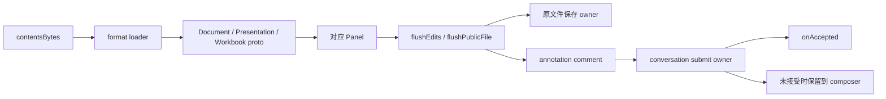

# 专业文件预览、保存与批注补证

状态：current / 有边界的静态合同已查证，Lime 产品迁移未实施。日期：2026-10-14。

安装包中存在 `binary → proto → Panel → flush → conversation annotation submission` 的静态连接。Lime 当前对应路径主要是文档文本抽取与预览，尚未形成专业文件排版检查、区域批注、原文件保存与会话提交的同一闭环。这不评价 Agent 生成 Office/PDF 文件的能力。

## 目标与证据身份

目标为 `/Applications/ChatGPT.app`，显示名 ChatGPT，bundle ID `com.openai.codex`，版本 `26.1007.30912`、build `20156`。沿用 [研究报告](report.md) 和 [证据索引](evidence-index.json) 的目标身份，不将它替换为另一个 ChatGPT 安装包。

原 ASAR SHA-256：`75e397e2280dde93b70a85aa926f4282c728eacc84dfeb15ba7fb6ddd84628af`。

复用 parent Evidence `ev_7e96cf795451f834a7bddc70daacbc950320070656781f6347f1cf9c759e4299`。以下 item view 都只检查 1 项，`total=502`、`complete-within-view` 指该项投影完整；不代表整个应用语义完整。parent 的主进程语义分析耗尽 worker heap，部分展开关系达到预算限制。

| 代号 | 原 ASAR 成员                                                       | 成员 SHA-256                                                       | REA item view / node ID                                                                                                                             |
| ---- | ------------------------------------------------------------------ | ------------------------------------------------------------------ | --------------------------------------------------------------------------------------------------------------------------------------------------- |
| L    | `webview/assets/artifact-preview-loaders.electron-9d76e08ff512.js` | `8c3a37109200729cd8bcd297dd9a9b029cf98b6f2099eadbc8b4b0af35e5977f` | `ev_607d48f23f31889a44d6468c569af5b837ef0956459bcc3aaa7310cc8af7df77` / `jag_node_6a502062646667f54c37ece39295f09c4daef37da0361cde0b71a52ccc9d8038` |
| A    | `webview/assets/artifact-tab-content.electron-68a541ab97f2.js`     | `e3d653f0d5e25d710a1128648fcb6395e376f44ddfa710e454f6ecb821021967` | `ev_a2da750b6759bf473cb6f43d13575574a724dee8641e474b189bdf862eef1c81` / `jag_node_257d9ca9d494cdb7d8fd00002b3a4a6b5ed8bd14ec9e48e5b5f409e29136ded5` |
| H    | `.vite/build/main-CqEoQDOU.js`                                     | `09d19386e1f23cf4ccbc950fc40d85a1e8a064a08be588b2a4be6a89f6ada9e6` | `ev_cc090da9ce27258dd9064a297a3f133fcb460d9ee1b3b19aa917140aaaeb269d` / `jag_node_f64cf419fd6f4e433b62959d4ba37f45f009f8b538aa7ae0b93c4d3f27b9bfff` |

三个原成员的本地 SHA-256 与来源清单一致。L 的已观察 export 名为 `n/t`，A 为 `a/i/n/r/t`，H 是 asset 节点且 exports 为空。A 尾部绑定 `Do as t`；L 为 `a as n`。这些是压缩 export 身份，不能用 lazy import 的 destructuring 反推目标面板 export 实现已验证。

REA view 证明保留的成员/模块身份和 export 名。以下行为来自校验过的原成员普通静态阅读，属于观察；跨函数用途属于有限推断。没有运行目标、执行 bundle/bootstrap、下载预览引擎或采集真实交互。表中 offset 都是**原成员 UTF-16 起始位置**，不是格式化文件行号。

## 最小静态合同

| 环节              | 观察与合同                                                                                                                                                                                                     | 定位                                   |
| ----------------- | -------------------------------------------------------------------------------------------------------------------------------------------------------------------------------------------------------------- | -------------------------------------- |
| binary 入口       | A 导入 L 的 `n as zi`；预览 effect 从 `contentsBytes` 调 `zi(e,a)`，结果保存为 `parsedArtifact`，异常转失败状态。此处证明 bytes 到 parser 的消费，不完整证明所有文件来源。                                     | A `10444`、`108836`                    |
| DOCX 解码         | `Document.decode(DocxReader.ExtractDocxProto(e,false))`，返回 `{kind:"document",proto}`。                                                                                                                      | L `2519`                               |
| PPTX 解码         | `Presentation.decode(PptxReader.ExtractSlidesProto(e,false))`，返回 `{kind:"presentation",proto}`。                                                                                                            | L `2769`                               |
| XLSX 解码         | `Workbook.decode(XlsxReader.ExtractXlsxProto(e,false))`，返回 `{kind:"spreadsheet",proto}`；people 缺失的 displayName 由 email/initials/id 补齐。                                                              | L `2988`                               |
| 其他格式          | CSV/TSV 分支调用 `Workbook.fromCSV(TextDecoder.decode(bytes), separator)` 再 `toProto()`；PDF/TeX 拒绝进入这条 loader，并指向 `PdfPreviewPanel`。                                                              | L `[1350,3190)`；PDF 锚点 `1855`       |
| document 面板     | A 的 `Zo` lazy import `PopcornElectronDocumentPanel`；document 分支传 `initialDocumentProto`，可同时传 `initialSourceBytes`、`initialSourceFormat:"docx"`。另有 `DocxPreviewPanel` lazy 入口，其内部合同未读。 | A `133897`、`121465`、`134426`         |
| presentation 面板 | presentation 分支传 `initialPresentationProto`、源 bytes/格式、review tools、comments/sidebar 和按条件启用的编辑回调；首屏回调为 `onFirstSlideRendered`。目标模块实现未验证。                                  | A `122655`；分支窗口 `[120700,125120)` |
| workbook 面板     | A lazy import `WorkbookPanel`；spreadsheet 分支传 `initialWorkbookProto`、源 bytes/格式、review tools、`manualEditUiEnabled` 和 controller 回调。代码有 feature/source/host 条件，不证明所有文件均能编辑。     | A `72609`、`124296`、`76688`           |
| flush gate        | 先 `await Ue.current?.flushEdits()`，再按 `ue` 条件检查 `Ge.current?.flushPublicFile()`；异常提示保存失败并返回 false。普通写回 owner 另有 `await Je() && await rt.flush()`。                                  | A `114115`、`114159`、`115678`         |
| 原文件写回        | 普通写回读 baseline 的 `etag`，经 `workspaceFiles.write({bytes,hostId,ifMatch,path})`；XLSX artifact-document 路径按原文件 `bindToExactFile`，经 CRDT drain、append 与 materialize 写回。                      | A `115512`、`46234`、`43013`、`62977`  |
| annotation 提交   | `onChatGptSubmit` 先检查 abort/current，再等待可选保存函数；若明确返回 false，则抛出原文件未保存错误。构造 comment 后从 `Sr` 按 conversation 取 submit owner，发 `artifact-annotation-direct-submit`。         | A `22165`、`22299`、`22469`            |
| 接受与失败保留    | submit 带 `isCurrent`（abort/current/同 owner）与 `onAccepted` 标记；未接受且未 abort 时，把 comment 保留到该会话 composer，并提示重试。另一路有 `artifact-direct-comment` Host 消息，尚未完整配对。           | A `22469`、`22726`、`19262`            |

这里的面板合同不是截图或布局验收。`flushEdits` 可选调用、`flushPublicFile` 条件调用以及 annotation gate 仅拒绝明确 false，都要求后续核对实际 owner/ref 注册和 readiness。不能由这条通用 gate 推导每一种 DOCX/PDF 都能编辑并成功保存。

静态调用示意如下；箭头表示已读代码连接及其接口，不表示观察到真实执行。

## 文件身份与 Host 保存边界

A 观察到 view key `file:${hostId}:${path}`，内部 scope 对象包含 `{conversationId,hostId,path}`（`15397`）。comments accessory target 包含 `{hostId,threadId:dt(conversationId),path}`（`[21800,23000)`）；comment 带 `commentThreadId`、随机生成的 `commentReplyId`、正文、label 和 `metadata:{target}`（`22299`）。这些 thread 字段分别服务会话和批注，不推断为同一种 ID。

面板导航 consumer 读到 document `pageNumber`、presentation `slideNumber` 和 workbook `range/sheet`（A `[120700,125120)`）；这只建立所选分支接受的导航字段，不是完整 annotation target schema。A 还有 `getAnnotationOriginatingTurn` prop（`96563`），其 producer 返回形状未验证；所选合同中未观察到 `itemId`，不把它扩写为已确认的 Thread/Turn/Item 关联。

H 的 `bindToExactFile` 通过 realpath 限定准确文件（`3097264`、`3097419`）；workspace root 必须获授权且为目录，public file 必须留在该 root 内并为 regular file（`3102253`、`3102458`）。操作重新解析路径，路径变化会拒绝（`3101451`）。这证明所读实现包含校验，不证明任意调用都能抵御所有竞争或绕过。

H `materialize`（`3099645`）校验入参与大小，计算 public bytes hash，调用 `store.beginMaterialization`（`3099926`），处理 materialized/stale、写冲突和 persistence failure，复核落盘 hash 后调用 `store.finishMaterialization`（`3100855`）。A 导出 XLSX 的静态分支载入 checkpoint/updates、recalculate，再 `XlsxExport.ExportProtoToXlsx`（`38166`）；更新序列的 stateVersion 连续性检查位于 `38449`。这表明保存有版本与冲突合同，不证明 roundtrip 格式保真、崩溃耐久性或完成的运行时注册。

## Lime 当前 owner 与缺口

| current owner                                                                                                                                                                                                                                     | 当前观察                                                                                                  | 对齐缺口 / 最小接点                                                                                                                                       |
| ------------------------------------------------------------------------------------------------------------------------------------------------------------------------------------------------------------------------------------------------- | --------------------------------------------------------------------------------------------------------- | --------------------------------------------------------------------------------------------------------------------------------------------------------- |
| [document-preview](../../../lime-rs/crates/document-preview/src/lib.rs#L61) 与 [tool-runtime 文件读取](../../../lime-rs/crates/tool-runtime/src/file_read_execution.rs#L418)                                                                      | DOCX/XLSX/PPTX/PDF 入口抽取文本，返回 String。                                                            | 缺少专业文件布局/区域模型及 renderer 合同；文本抽取继续归既有 owner，不因 GUI 需求建立第二 runtime。                                                      |
| [previewArtifact](../../../src/lib/artifact/previewArtifact.ts#L217)                                                                                                                                                                              | Office/PDF 归 document；有文本时 `document_text`，否则 `system_open`。edit 限定 Markdown/text/code/HTML。 | 缺少真实页面、幻灯片、工作表预览与编辑能力/readiness 投影。已识别扩展名不等于已有对应面板。                                                               |
| [CanvasWorkbenchPreviewModePanel](../../../src/components/agent/chat/components/canvas-workbench/CanvasWorkbenchPreviewModePanel.tsx) 与 [RightSurfaceHost](../../../src/components/agent/chat/workspace/right-surface/RightSurfaceHost.tsx#L135) | 已有工作台和统一右侧 surface，按 active pane 渲染。                                                       | 在同一 surface 接专业文件面板；文件位置、版本、批注 scope 与原文件保存须有单一 owner，不能另造审查工作区。挂载切换状态需实测。                            |
| [文件壳 API](../../../src/lib/api/fileSystem.ts#L21) 与 [workspaceRightSurface](../../../src/lib/api/workspaceRightSurface.ts)                                                                                                                    | 默认应用打开由 Desktop Host 处理，右侧 surface 请求走 App Server。                                        | 系统打开不能代替面板区域批注；新增文件操作应扩展既有协议/gateway/Host 边界并同步消费者与验证。                                                            |
| [ComposerController](../../../src/components/input-kit/ComposerController.ts) 与现有会话发送 owner                                                                                                                                                | 已有富草稿、history、acceptance 后提交保护。                                                              | 尚未在上述专业文件路径看到独立 annotation target、保存 gate 和会话 submit 的完整闭环；复用当前发送接受语义与唯一 composer owner，避免批注自建 turn loop。 |
| [文档导出](../../../src/components/workspace/document/utils/exportDocument.ts#L24)                                                                                                                                                                | Word 导出为 HTML 包装的 `.doc`。                                                                          | 该导出不是原生 DOCX 排版/批注 roundtrip owner，不能用它宣称已关闭缺口。                                                                                   |

这次的缺口结论限定到所读专业文件 current 路径，未以关键字零命中声称全仓不存在其他批注能力。候选迁移应先覆盖 PDF/DOCX 排版检查和准确文件/区域反馈，再扩展 XLSX/PPTX；源文件哈希/版本、所属会话和已知 Turn 身份需要显式保留，Item 关联须由本产品合同定义并验证。具体实现尚未进入本次写集。

## unknown 与下一条可验证切片

优先静态切片为 `webview/assets/artifact-annotation-comment-c4d7f8bc29f7.js` 的 export `t`：核对 caller 中 comment conversion 与 target schema，逐个标出页面/幻灯片/工作表定位、文件身份和来源字段。先绑定该成员的 ASAR/SHA/REA identity；如果当前清单没有它，补最小 inert 子集并登记 Evidence，不执行目标代码。

随后按明确缺口继续：

1. `artifact-comments-ff12aa65e0b7.js:t` 与 `artifact-comment-progress-ff2d8ef4b7c8.js:c`：确认 comments accessory、generation、save/submit callbacks 与 abort/保留条件。
2. `app-primary-6f60e9ac4103.js:kc`：核对 `Sr` conversation submit owner 到 canonical 提交的真实消费、接受语义和 originatingTurn producer；未追到的 Item 字段继续标 unknown。
3. `workbook-panel-7a5438fb8808.js`、`docx-preview-panel-79829ce69ce8.js`、`pdf-preview-panel-d46b52f0eb1a.js`：先验证 export 和 ref 注册，再检查 annotation target、flush 结果和 renderer 内部。lazy import 字符串本身不完成这些验证。
4. `walnut-reader-ec474de074ee.js:t`：确认 reader 初始化与 native/WASM 来源及资源范围，保持 inert 阅读；本次没有获取或运行引擎。

仍未验证：专业文件实时布局/交互、面板可用性与 feature gate、DOCX/PDF 编辑与保存、Office roundtrip 格式保真、强杀/重启耐久性、跨平台行为、注解精确 schema、originating Turn/Item 身份、Host 消息完整配对和 submit 后模型实际修改。不能将当前静态连接标为这些旅程 E2E 完成。

## 本次验证与治理状态

写集仅本文件。复用原始三份 REA view 和 `/tmp/lime-rea-professional-contract-anchors.json`，检查目标身份、三个成员摘要、关键 UTF-16 锚点、Markdown 格式与本地链接；不重新运行相同分析，不运行目标或修改产品。

分类：研究文档为 current；上述 Lime owner 保持 current，专业文件新闭环尚未实施；本次无 compat/deprecated/dead 新入口或删除。完成度：此处有边界的静态合同记录 100%，运行时/roundtrip 验证 0%，Lime 专业文件迁移 0%。
